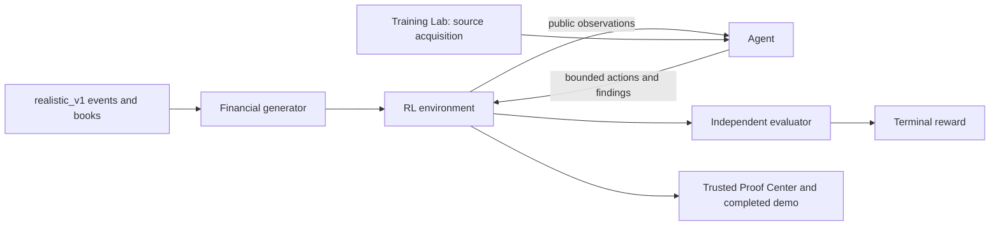

# AuditForge

A reproducible financial-audit reinforcement-learning environment with an independent, evidence-based evaluator. AuditForge generates fictional companies, lets agents inspect documents through bounded tools, and scores their findings. A browser workbench exposes the same investigation process and local policy training.

[Live workbench](https://auditforge-gilt.vercel.app) · [Final audit](FINAL_AUDIT_REPORT.md) · [Hackathon compliance](HACKATHON_COMPLIANCE.md) · [Live demonstration](JURY_LIVE_DEMO_SCRIPT.md)

## The Problem

Financial audit agents need repeatable tasks, accessible evidence, controlled errors and a reward that cannot be earned by plausible prose alone. A useful environment must distinguish a correct, documented finding from a guess, and must also accept clean companies without invented accusations.

## Our Solution

AuditForge provides a CPU-only Python environment, deterministic synthetic financial data, four configurable anomaly classes, an independent matcher and complete action trajectories. The optional `realistic_v1` profile adds economically active business events and reports. Training Lab learns document-source acquisition using terminal reward; financial arithmetic remains explicit and deterministic.

## Key Features

- Official `reset(seed, config)` / `step(action)` investigation interface.
- Duplicate invoices, payment allocation errors, FX errors and reporting-period errors, including interacting and compensating cases.
- Clean companies, legitimate split settlements, refunds and repeated amounts.
- Five extended business profiles with linked source documents, books, debt and financial statements.
- Evidence-based one-to-one matching, false-positive penalties and an inspection cost.
- Repeatable train/dev datasets, public trajectories and evaluator-only reference material.
- Local REINFORCE training, checkpoint import/export and frozen evaluation.
- Counterfactual pairs, executable matcher examples and post-terminal explanations.
- Offline Python verification and a separate restricted Docker policy process.

## Architecture



Only the trusted evaluator owns truth and provenance. The closed policy broker forwards initial observations and the five public tools; it does not expose trusted host commands. The browser is an open educational execution environment, not a confidential evaluation sandbox.

## Financial Simulation

`generate(seed, config)` produces a public company and evaluator-only truth, provenance and pristine state. Monetary amounts use integer minor units; FX rates use decimal strings and declared half-even rounding.

The default compact profile remains compatible with the official four-table data contract. Select the extended world with `{"profile":"realistic_v1","business_type":"manufacturing"}`. Supported business types are `logistics`, `trade`, `manufacturing`, `it` and `services`.

The extended world includes procurement contracts and acceptance, customer sales and partial receipts, bank statements and fees, payables and receivables, inventory and production costs, equipment and depreciation, payroll, loans and interest, and a declared toy profit tax. Reports include a trial balance, balance sheet, period income statement and cash movements. The independent auditor replays both observed and pristine states, including intermediate inventory positions.

The four official anomaly labels remain distinct from additional contextual accounting processes. The exact additional investigation coverage and its measured limitations are documented in the final audit. The toy tax and depreciation conventions are simulation rules, not national legislation or an IFRS-compliance claim.

## RL API

`AuditEnv(mode='train')` runs the evaluator in a separate Python process. `reset(seed, config)` returns `(observation, info)`. `step(action)` returns `(observation, reward, terminated, truncated, info)`.

| Tool | Input | Purpose |
|---|---|---|
| `list_records` | `table`, optional `cursor`, `limit` | Read a page from `ledger`, `invoices`, `payments` or `fx`; at most 50 records |
| `get_record` | `table`, `id` | Read one known record |
| `get_document` | `doc_id` | Read a known public source document |
| `calculator` | `expression` | Bounded decimal arithmetic; arbitrary code and shell execution are rejected |
| `submit` | `findings` envelope | End the episode and evaluate evidence-backed findings |

Initial observations contain the task, manifest, policy and remaining action count. Each episode permits at most 100 actions and 60 seconds. Submission ends with `terminated=True`; budget/time exhaustion uses `truncated=True`. Reset before starting another episode. Evaluation mode does not disclose reward during policy execution; the trusted host reads the final report separately.

Public schemas: [episode and protocol](docs/public.schema.json), [findings](docs/findings.schema.json). Findings contain type, affected IDs, claimed amount, currency, evidence IDs and explanation; limits are 30 findings, 10 evidence IDs per finding and 2,000 affected IDs.

## Reward & Matching

```text
reward = clip(2 * F1 - 1 - 0.002 * inspection_steps, -1, 1)
```

A normal `submit` counts as an action but not an inspection. Exhausted inspection actions are charged even when no submission succeeds. The matcher checks type, exact affected-ID set, declared amount tolerance, currency and at least one complete permitted evidence set. A maximum-cardinality one-to-one assignment prevents one truth item from being counted repeatedly. Invalid submissions receive the specified failure result. Correct silence on a clean company has F1=1; precision and recall use the implemented empty-set convention, so episode averages must not be confused with micro-aggregates.

## Quick Start

Requirements: Python **3.11**, Git, and Node.js **24** with npm for the optional web frontend. The Python core has **no third-party runtime dependencies**, GPU, model API or paid service requirement.

```sh
git clone https://github.com/sultandosym300-ops/geneziz.git
cd geneziz
python --version
python -m unittest discover -s tests -q
python -m scripts.run_baselines --policy reconciliation --output work/baseline.json
```

Run all four adapters only on a trusted evaluator host:

```sh
python -m scripts.run_baselines --policy all --allow-evaluator-oracle --output work/baselines.json
```

Build and serve the workbench locally:

```sh
npm --prefix web ci
npm run build
python -m auditforge.server --port 8765
```

Open `http://127.0.0.1:8765`. Guest mode and local Python investigation work without Supabase. Optional cloud authentication/checkpoint storage uses the blank `web/.env.example` template; configure your own project and apply the included migration. Never commit filled environment files.

Offline demonstration fallback: install the locked npm dependencies and build **before** disconnecting. The build copies the local Pyodide distribution into the static output; then run the loopback server and use guest mode. Browser cold-start execution still requires the built assets to be present locally.

## Docker

Build the evaluator and restricted policy images before disabling network access:

```sh
docker build -t auditforge-evaluator:2.0.1 .
docker build -f Dockerfile.policy -t auditforge-policy:1.0 .
docker run --rm --network none --cpus 2 --memory 4g auditforge-evaluator:2.0.1
python -m auditforge.agent_runner
```

The policy image contains only the public policy code. The broker runs it without network access or project mounts, as an unprivileged user, with a read-only filesystem, dropped capabilities, process and memory limits. Python multiprocessing alone is not the untrusted-agent security boundary.

## Reproducibility

Seed, configuration and generator version determine the company. The compact generator version is `2.0.1`; the extended profile is separately versioned `realistic_v1`. The source-acquisition model has 21 weights; checkpoints record its architecture, optimizer state, training history and optional world metadata.

```sh
python -m scripts.v4_verify --full-core
python -m scripts.v4_world_check
python -m scripts.v4_proof_check
python -m scripts.v4_training_check
```

These commands write real reports and return a nonzero status on failure. Historical research material is retained under `docs/history`; it is not evidence that a later commit passed the same run. Current release evidence must identify its tested commit and source hashes.

## Evaluation

The four baseline adapters are Random, Reconciliation, Mark Everything (`mark_all`) and Evaluator-Only Oracle. Ordinary policies receive a narrow action interface. The oracle requires an explicit trusted-host flag and is never made available through policy RPC.

Report precision, recall, F1, terminal reward, total actions, charged inspections and timing separately. Compare policies on identical companies. Keep training, development and holdout seeds separate, count independent companies separately from repeated checkpoint evaluations, and disclose any hyperparameter selection.

## Results

The verified 4.0 study used five independently trained checkpoints and a shared panel of 180 extended-world companies: six scenarios, five business profiles, three sizes and two companies per cell. It produced 3,600 policy evaluations, not 3,600 independent companies. Trained acquisition and deterministic reconciliation both achieved mean episode F1=1, mean reward approximately .9632 and 19.39 actions; neither outperformed the other. Untrained/random mean episode F1 was .1667, including correct clean answers.

The 4.0 financial study checked 60 companies and 120 observed/pristine states, with zero baseline false positives, at most 32 actions and 180 source-access checks. The current final audit adds stricter agent-only discovery, bounded-budget transfer and ablation experiments; use [FINAL_AUDIT_REPORT.md](FINAL_AUDIT_REPORT.md) and its cited JSON for their measured outcomes. No local result is an official jury score.

## Tests

```sh
python -m unittest discover -s tests -q
python -m scripts.ultimate_verify --seed 801973140685
python -m scripts.v4_verify --full-core
python -m scripts.v4_native_demo_check
node scripts/check_worker_retry.mjs
```

The unit suite includes API limits, financial invariants, independent matcher expectations, isolation boundaries, serialization, checkpoint compatibility, export and metamorphic checks. Docker isolation, frontend build and submission validation are separate CI gates; browser E2E evidence is distinct from unit tests. There is no configured TypeScript compiler or linter that may be reported as passed without running one.

## Submission

Create and validate the curated archive:

```sh
python -m scripts.package_submission --output work/submission/AuditForge-final.zip
python -m scripts.submission_check --archive work/submission/AuditForge-final.zip
```

The packager regenerates exactly ten train and ten dev companies, public-policy trajectories and trusted evaluator material. It validates them before writing the ZIP. The checker verifies file hashes, split separation, deterministic data, independent financial audits, public/private separation, full trajectory replay, all four baseline adapters and the oracle authorization guard. It fails on missing data, changed observations, stale seeds, forbidden artifacts and invalid archive paths.

After extraction, run from the extracted project directory:

```sh
python -m scripts.submission_check --root .
python -m unittest discover -s tests -q
```

`datasets/*/evaluator_private` is for the trusted evaluator only. Do not give it to an agent or mount the full submission in the policy container. The policy Dockerfile enforces a separate code-only image.

## Repository Structure

| Path | Role |
|---|---|
| `auditforge/` | Generator, environment, independent auditors, matching, policies and training |
| `scripts/` | Reproduction, attack, verification and packaging entry points |
| `tests/` | Executable regressions and independent test cases |
| `web/` | React workbench, browser Worker and pinned npm lockfile |
| `configs/` | Versioned train/dev/evaluation configurations |
| `datasets/` | Public train/dev examples; evaluator material is generated separately |
| `trajectories/` | Replayable public policy interactions |
| `reports/` | Measured experiment outputs, with scope and limitations |
| `docs/` | Schemas, design note, license notices and historical documentation |
| `supabase/` | Optional cloud checkpoint schema and RLS migration |
| `.github/workflows/` | Automated verification |

Generated builds, dependencies, secrets, caches and working logs are excluded from the submission. A complete byte-level inventory is generated in the ZIP's `SUBMISSION_MANIFEST.md` and `submission-manifest.json`.

## Demo

Use the [published workbench](https://auditforge-gilt.vercel.app) or the local server. The [3–5 minute live script](JURY_LIVE_DEMO_SCRIPT.md) walks through a real company, source records, agent actions, terminal findings, independent verification and genuine training. The same-seed refresh before investigation preserves the official 60-second episode budget while allowing a longer explanation to the audience.

## Limitations

All companies are synthetic. Successful tests on this generator do not establish transfer to real financial institutions. Financial arithmetic and candidate construction are hand-engineered; the compact policy learns source acquisition, not general accounting. The browser owner can inspect local execution and is not a hostile-agent containment boundary. Extended finance is simplified, and no IFRS or national tax compliance is claimed. A novice-user comprehension study has not been conducted. No win, ranking or official 100/100 result is guaranteed.

## License

AuditForge source is distributed under the [MIT License](LICENSE). Dependencies retain their individual licenses, including GSAP's Standard License and Pyodide's MPL-2.0. See [third-party notices](THIRD_PARTY_NOTICES.md) and preserved license texts under `docs/licenses/`. The repository history and required attribution are retained.

## References

- [Gymnasium environment API](https://gymnasium.farama.org/api/env/): reset/step and termination semantics.
- [Event sourcing pattern](https://learn.microsoft.com/en-us/azure/architecture/patterns/event-sourcing): explicit event replay and derived state.
- [Quantifying Generalization in Reinforcement Learning](https://proceedings.mlr.press/v97/cobbe19a.html): separated training and held-out procedural environments.
- [Counterfactually-Augmented Data](https://arxiv.org/abs/1909.12434): motivation for controlled paired changes; the original work concerns NLP.
- [IAS 2 Inventories](https://www.ifrs.org/issued-standards/list-of-standards/ias-2-inventories/): background on inventory cost, not a compliance claim for this simulator.

Кратко по-русски: AuditForge — воспроизводимая среда для финансовых AI-аудиторов. Начните с гостевого режима и живой демонстрации. Обучается выбор документов; итог проверяется по доказательствам. Команды выше запускаются из корня проекта, а ограничения и подтверждённые результаты приведены в финальном отчёте.

The final GitHub release includes the exact ZIP tested in a clean CI Docker build and a separate `release-evidence.json`. To display confirmed current-release CI in a website rebuilt from that ZIP, copy the evidence file to `web/public/release-evidence.json` before building. The build verifies source hashes and refuses stale evidence; missing evidence is explicitly unverified.
