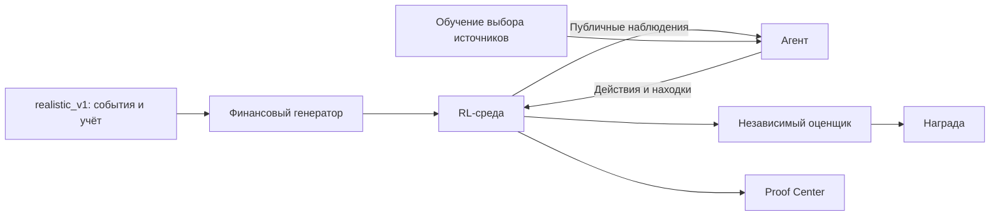

# AuditForge — среда обучения финансовых ИИ-аудиторов

**Хакатон Genesis · кейс FinTech.** AuditForge создаёт воспроизводимые вымышленные компании, предоставляет агенту ограниченный доступ к документам и независимо оценивает доказанные нарушения. Сайт позволяет расследовать компанию и обучать политику выбора источников непосредственно в браузере.

[Открыть сайт](https://auditforge-gilt.vercel.app) · [Соответствие кейсу](HACKATHON_COMPLIANCE.md) · [Итоговый аудит](FINAL_AUDIT_REPORT.md) · [Сценарий показа](JURY_LIVE_DEMO_SCRIPT.md)

## Исследовательское продолжение 2.1.0

Создано 23 ноября 2026, отдельно от исходной сдачи Genesis. Старый релиз
`genesis-2026-fintech-final` и его архив сохраняются. Стандартный генератор
остаётся версии 2.0.1; добавлен необязательный `investigation_v1`.

Новый режим Training Lab обучает порядок запросов и остановку при бюджете
6/10/16/100 действий, показывает реальные train/validation, отдельные тесты,
сильные baseline и документы каждого решения. REINFORCE/self-critical и
Actor-Critic используют общий финансовый decoder; арифметика не обучается.

**Превосходство RL не подтверждено.** В двух заранее разделённых исследованиях
сохранено 18 432 оценочных запуска на двух панелях по 48 test + 16 transfer
компаний. Повторы трёх checkpoint не считаются независимыми компаниями.
В V2 при бюджете 10 выбранный по validation Actor-Critic получил reward
0.693436 против 0.874305 у поиска гипотез. Отрицательные результаты сохранены.

[Новый аудит](AUDITFORGE_FINAL_INDEPENDENT_AUDIT.md) ·
[Исследование RL](AUDITFORGE_RL_BENCHMARK.md) ·
[Атакующие проверки](AUDITFORGE_ADVERSARIAL_REPORT.md) ·
[Матрица кейса](AUDITFORGE_GENESIS_COMPLIANCE.md) ·
[Демонстрация](AUDITFORGE_JURY_DEMO.md) ·
[Ограничения](AUDITFORGE_LIMITATIONS.md)

```sh
python -m scripts.sequential_demo --output work/sequential-demo.json
python -m scripts.sequential_acceptance
python -m scripts.sequential_adversarial --output work/sequential-adversarial.json
```

Зафиксированные результаты и checkpoint находятся в `reports/final-sequential-*`.
Независимый reference evaluator и новые регрессии увеличивают полный набор
до 214 тестов; проверяются 23 намеренных дефекта. `ultimate_verify` включает
mutation testing: отдельный повтор мутаций после него не нужен.
Новый закрытый агент: `Dockerfile.sequential-policy`, образ
`auditforge-sequential-policy:1.0`; после сборки — `python -m scripts.sequential_container`.

## Для жюри

- Python 3.11; ядро не требует сторонних Python-пакетов, GPU или платных API.
- Быстрая проверка: `python -m unittest discover -s tests -q`.
- Полная проверка ядра: `python -m scripts.ultimate_verify --seed 801973140685`.
- Комплект: `configs/`, `datasets/`, `trajectories/`, четыре агента в `scripts/run_baselines.py`, схемы и архитектура в `docs/`.
- Финальный ZIP и подтверждение CI приложены к [релизам](https://github.com/sultandosym300-ops/auditforge/releases). Используйте архив из успешного запуска, а не произвольную копию рабочей папки.
- Живая демонстрация: войдите гостем, завершите вводную инструкцию и нажмите «Показать живую демонстрацию».

## Задача и решение

Финансовому агенту недостаточно правдоподобного объяснения: нужны корректные суммы, затронутые записи и документы. AuditForge объединяет детерминированную генерацию, контролируемые нарушения, ограниченный интерфейс расследования, независимый matcher и точную функцию награды. Чистые компании позволяют проверять ложные обвинения.

## Возможности

- Четыре типа нарушений: дубликаты счетов, распределение платежей, валютная конвертация и отчётный период; предусмотрены взаимодействия и компенсации ошибок.
- Пять бизнес-профилей: логистика, торговля, производство, ИТ и услуги.
- Связанные договоры, счета, платежи, банковские документы, проводки и финансовые отчёты.
- Повторяемые train/dev-эпизоды, траектории и отдельный скрытый эталон оценщика.
- Обучение REINFORCE, сохранение и импорт модели, проверка на новых компаниях без изменения весов.
- Проверки доказательств, контрфактические примеры и объяснения после завершения эпизода.
- Изолированный агент Docker и автономное Python-ядро; интерфейс доступен на русском, казахском и английском.

## Архитектура



Истина и provenance принадлежат доверенному оценщику. Изолированный брокер передаёт агенту только публичные наблюдения и пять инструментов. Браузер — открытая учебная среда: владелец может исследовать её память, поэтому закрытое оценивание выполняется через Docker.

## Быстрый запуск

Нужны Git и Python **3.11**. Для сайта дополнительно нужен Node.js **24** с npm; CI также проверяет сборку на Node.js 22.

```sh
git clone https://github.com/sultandosym300-ops/auditforge.git
cd auditforge
python --version
python -m pip install -r requirements.txt
python -m unittest discover -s tests -q
python -m scripts.run_baselines --policy reconciliation --output work/baseline.json
```

Сайт и локальный сервер:

```sh
npm --prefix web ci
npm run build
python -m auditforge.server --port 8765
```

Откройте `http://127.0.0.1:8765`. Гостевой режим не требует Supabase. Для облачного входа и сохранения используйте пустой шаблон `web/.env.example` и миграции `supabase/`; заполненные настройки не включаются в Git и ZIP. Для показа без интернета установите зависимости и соберите сайт заранее: локальная сборка включает Pyodide. Первая загрузка Python в браузере зависит от передачи этих файлов.

## Docker и проверка без сети

Соберите образы до отключения интернета:

```sh
docker build -t auditforge-evaluator:2.0.1 .
docker build -f Dockerfile.policy -t auditforge-policy:1.0 .
docker run --rm --network none --cpus 2 --memory 4g auditforge-evaluator:2.0.1
python -m scripts.verify_container
python -m scripts.jury_broker
```

Агент запускается непривилегированным пользователем, без сети, дополнительных capabilities и доступа к каталогу проекта, с файловой системой только для чтения. `python -m auditforge.agent_runner --trusted-native` предназначен для доверенной локальной разработки и не заменяет контейнерную изоляцию.

Полная проверка распакованного комплекта тем же способом, что в CI, на Linux/macOS:

```sh
docker build -t auditforge-submission:final .
docker run --rm --network none --cpus 2 --memory 4g --mount type=bind,source="$(pwd)",target=/submission -w /submission auditforge-submission:final python -m scripts.ultimate_verify --seed 801973140685
```

## Финансовый мир

`generate(seed, config)` формирует публичную компанию и отдельные truth, provenance и корректный исходный учёт. Суммы хранятся в целых минимальных денежных единицах; курсы — десятичными строками, округление half-even задано явно. Компактный профиль сохраняет контракт кейса.

Расширенный профиль: `{"profile":"realistic_v1","business_type":"manufacturing"}`. Значения деятельности: `logistics`, `trade`, `manufacturing`, `it`, `services`. Контекст включает закупки, продажи и частичные оплаты, банковскую сверку, запасы, производство, основные средства, зарплату, кредиты и учебный налог. Независимый аудитор восстанавливает наблюдаемый и исходный учёт, включая промежуточные остатки.

Четыре официальных типа нарушений отделены от дополнительных процессов. Налоговая модель учебная; соответствие IFRS и национальному законодательству не заявляется.

## RL API

`AuditEnv(mode='train')` запускает оценщик отдельным процессом. `reset(seed, config)` возвращает `(observation, info)`, `step(action)` — `(observation, reward, terminated, truncated, info)`.

| Инструмент | Параметры | Назначение |
|---|---|---|
| `list_records` | `table`, `cursor`, `limit` | Страница ledger/invoices/payments/fx, максимум 50 записей |
| `get_record` | `table`, `id` | Одна известная запись |
| `get_document` | `doc_id` | Публичный исходный документ |
| `calculator` | `expression` | Ограниченная десятичная арифметика без shell и произвольного кода |
| `submit` | `findings` | Завершение и оценка доказанных находок |

Не более **100 действий и 60 секунд на эпизод**. Успешная отправка устанавливает `terminated=True`, исчерпание бюджета — `truncated=True`. В evaluation-режиме награда не раскрывается во время расследования. Схемы: [протокол](docs/public.schema.json), [находки](docs/findings.schema.json). Ограничения: 30 находок, 10 доказательств на находку, 2 000 затронутых идентификаторов.

## Matcher и награда

```text
reward = clip(2 * F1 - 1 - 0.002 * inspection_steps, -1, 1)
```

Отправка считается действием, но не инспекцией. Matcher проверяет тип, множество затронутых записей, денежный допуск, валюту и полный допустимый набор доказательств. Взаимно однозначное сопоставление максимальной мощности предотвращает повторный зачёт одной ошибки. Корректный пустой ответ на чистую компанию имеет F1=1; средние по эпизодам не следует смешивать с общей микроагрегацией.

## Данные, агенты и траектории

`configs/train.json` и `configs/dev.json` задают по 10 разных эпизодов. Публичные примеры находятся в `datasets/train/public` и `datasets/dev/public`. В ZIP эталон хранится отдельно в `evaluator_private`; его запрещено передавать агенту.

```sh
python -m scripts.run_baselines --policy random
python -m scripts.run_baselines --policy reconciliation
python -m scripts.run_baselines --policy mark_all
python -m scripts.run_baselines --policy oracle --allow-evaluator-oracle
```

Oracle — только доверенный эталон оценщика, не инструмент агента. Для всех четырёх адаптеров: `python -m scripts.run_baselines --policy all --allow-evaluator-oracle`.

`trajectories/trajectories.jsonl` содержит `episode_id, step, action, observation, reward, terminated, truncated` и метку политики. Финальный комплект генерирует 30 публичных прогонов по 10 train-компаниям; приватные ответы Oracle в эти траектории не включаются. Валидатор полностью воспроизводит действия, наблюдения, награды и флаги завершения.

## Проверка и воспроизводимость

```sh
python -m unittest discover -s tests -q
python -m scripts.ultimate_verify --seed 801973140685
python -m scripts.v4_verify --full-core
node scripts/check_worker_retry.mjs
node scripts/check_release_evidence.mjs
```

CI выполняет регрессионные, бухгалтерские, matcher/reward, контрактные и защитные проверки, сборку сайта, проверку комплекта, распаковку ZIP, чистую сборку Docker и полный прогон без сети с ограничениями 2 CPU/4 GiB. Ошибка любого обязательного этапа даёт ненулевой код. Распаковка использует принадлежащий runner каталог `$RUNNER_TEMP`, устраняющий прежнюю проблему прав.

Полный набор может идти дольше минуты: ограничение 60 секунд относится к отдельному эпизоду. `tracemalloc` измеряет выделения Python, а не RSS; реальные ограничения и пиковая память контейнера записываются через cgroup. Исторические исследования сохранены в `docs/history`; новые исследования отдельного продолжения находятся в `reports/final-sequential-*`. Отдельный linter/TypeScript checker не настроен и не заявляется выполненным.

## Подтверждённые результаты и ограничения

Предыдущий проверенный исходный коммит: `b31d77593064931aa53fe1ae33be9a0cac7fe59d`. В нём прошли 177 тестов, 20 проверок с намеренными дефектами, проверка чистого архива и ограниченного Docker. Это исходный уровень; результат нового коммита подтверждается только его собственным успешным CI и приложенным доказательством.

Ранее проведённая независимая проверка финансового мира охватывала 60 компаний и 120 наблюдаемых/исходных состояний, без ложных находок у сверки, максимум 32 действия. Исследование обучения: 36 независимых отложенных компаний, 5 обучающих seed, 5 бюджетов, 9 политик — 8 100 прогонов, а не 8 100 независимых компаний. На бюджете 100 обученная политика и сверка дают F1=1; детерминированный контроль выбора источников повторяет обученную политику. Превосходство обучаемых весов не доказано.

Все компании синтетические. Модель из 21 веса обучает выбор источников; финансовые расчёты и построение доказательств детерминированы. Перенос на реальные банки, официальная оценка жюри, победа и рейтинг не подтверждены. Проверка понимания интерфейса новичками не проводилась.

## Комплект сдачи

```sh
python -m scripts.package_submission --output work/submission/AuditForge-final.zip
python -m scripts.submission_check --archive work/submission/AuditForge-final.zip
```

После распаковки из корня проекта:

```sh
python -m scripts.submission_check --root .
python -m unittest discover -s tests -q
```

Валидатор проверяет состав, хеши, 10+10 эпизодов, независимую финансовую реконструкцию, приватность, четыре адаптера и повтор траекторий. Секреты, заполненные env, зависимости, кэши и рабочие логи исключаются. Машинный перечень — `submission-manifest.json`, полный список файлов — `SUBMISSION_MANIFEST.md` внутри ZIP.

Релиз содержит **тот же ZIP, который проверен в CI**, и отдельный `release-evidence.json`. Для подтверждения сайта, собранного из ZIP, скопируйте этот файл в `web/public/release-evidence.json` перед сборкой. Сборка проверяет хеши кода и отклоняет устаревшие доказательства. Без файла подтверждение явно не заявляется. Proof Center указывает точный коммит и успешный CI; Docker выполняется вне браузера.

## Структура

| Каталог | Содержимое |
|---|---|
| `auditforge/` | Генератор, среда, финансовые проверки, matcher, агенты и обучение |
| `scripts/`, `tests/` | Запуск, проверка, упаковка и регрессионные тесты |
| `configs/`, `datasets/`, `trajectories/` | Конфигурации, эпизоды и воспроизводимые действия |
| `web/` | React-интерфейс, Web Worker, зафиксированные npm-зависимости |
| `reports/` | Результаты ранее выполненных исследований |
| `docs/` | Схемы, архитектура, тексты лицензий и история |
| `supabase/` | Необязательная схема облачных checkpoint и RLS |
| `.github/workflows/` | Полная автоматическая проверка |

## Показ, лицензия и источники

[Сценарий на 3–5 минут](JURY_LIVE_DEMO_SCRIPT.md) показывает реальную компанию, документы, действия агента, находки, доказательства и обучение. Перед расследованием та же компания сбрасывается с тем же seed, чтобы сохранить 60-секундный бюджет.

Код распространяется по [MIT](LICENSE). Сохранены авторство, история и [уведомления о сторонних компонентах](THIRD_PARTY_NOTICES.md), включая GSAP Standard License и MPL-2.0 Pyodide. Оригинальные юридические тексты лицензий не переводятся и находятся в `docs/licenses/`.

Технические основания: [API Gymnasium](https://gymnasium.farama.org/api/env/), [восстановление состояния по событиям](https://learn.microsoft.com/en-us/azure/architecture/patterns/event-sourcing), [обобщение в RL](https://proceedings.mlr.press/v97/cobbe19a.html), [контрфактические данные](https://arxiv.org/abs/1909.12434). Эти источники объясняют подходы и не являются сертификацией финансовой модели.
